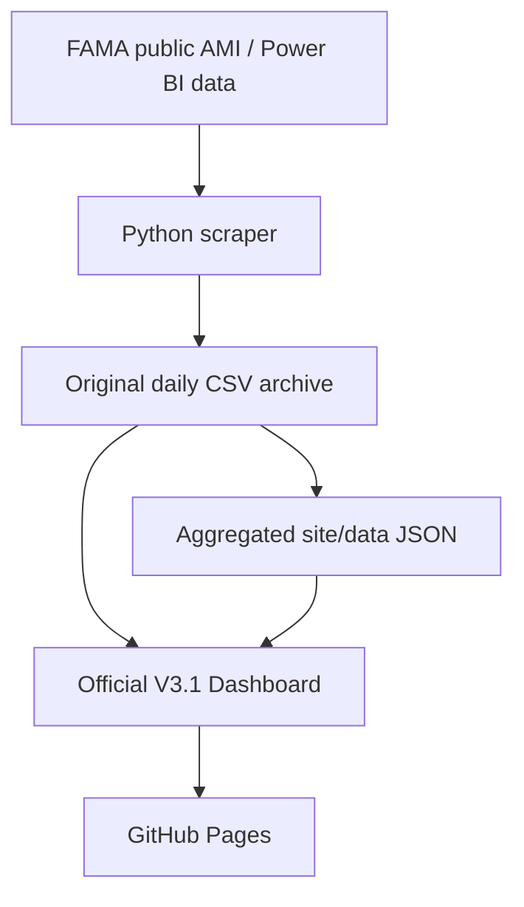

# BG Agro · FAMA Price Tracker

**Malaysia agricultural market prices, made easier to explore.**

An independent BG Agro dashboard built from publicly available **FAMA (Federal Agricultural Marketing Authority)** market price observations. Search produce prices, compare Malaysian states, inspect price changes and export original records for review.

**[Open Latest Dashboard V3.1](https://luke2929.github.io/bg-agro-price-tracker/)** · [Newest-first CSV Index](DAILY_PRICE_INDEX.md) · [Original CSV Archive](data/daily/) · [Automated Updates](https://github.com/Luke2929/bg-agro-price-tracker/actions/workflows/scrape.yml)

> **中文简介：** BG Agro 将 FAMA 的农业市场调查价格整理成简洁的 Dashboard。你可以按蔬菜、州属、日期和价格层级查询，比较历史变化，也可以将指定日期范围的原始数据下载成 Excel。数据按计划自动更新，**不是即时交易报价**。

The site root (`/`) now redirects to **V3.1**, the single official dashboard.
Old `/v3/` bookmarks redirect to V3.1 automatically; earlier code remains recoverable in Git history.

## V3.1 — consistent FAMA comparisons

The dashboard uses a transparent, stock-style **survey price** model, not an exchange-traded price feed:

- **Product identity:** variety, grade and unit are kept separate. Price level (Ladang, Borong, Runcit) and selected state are matched separately.
- **Daily market price:** equal-weight mean of observed FAMA market averages; repeated survey rows at one market do not give that market more influence.
- **1D:** compare with the most recent prior day that has observations in the **same markets**, searching at most 7 calendar days back. The actual baseline date is displayed.
- **7D / 30D:** use the closest survey on or before the 7/30-day target that shares markets and has a positive matched baseline, no more than 4/7 days older respectively. If that candidate has insufficient coverage, the comparison stays ineligible. Actual dates and both matched prices are displayed.
- **Price change:** `(current matched-market mean − previous matched-market mean) / previous matched-market mean × 100%`. A comparison requires at least one identical market. Changes from fewer than 3 matched markets are marked **low sample**. Comparisons covering less than half the current or historical markets are marked **low coverage**. Both are excluded from Top Movers.
- **Top Movers:** rank changes among products with **3+ matching markets and at least 50% coverage on both dates**. The table keeps measured changes visible with review markers. The ideas board and Creator Studio hold comparisons for review when the overall movement is at least 50%, a matched observation is at least 10 times its FAMA 14-day reference, or one market at least doubles or halves and removing it changes the headline by at least 10 percentage points.
- **History:** the 30/90/180-day chart displays recorded national/state averages only. Survey-market coverage can change, and missing days are never backfilled.
- **V3.1 locality:** choose `Negeri → Daerah → Lokasi` to see actual latest-day quotations. A district or location is calculated from its own surveyed markets, never substituted with a state mean. Historical district averages are not fabricated.
- **Archive completeness:** generated metadata includes an explicit list of archived CSV dates. A missing expected file is treated as a download error, while non-reporting dates remain genuinely absent. Per-day CSV content revisions prevent unrelated archive refreshes from invalidating every cached download.
- **Exports:** Excel keeps the original 17 CSV fields; PDF adds 4-page Quick View and a source-complete Mobile Report with internal Date → Negeri → Daerah → Lokasi bookmarks and links. Both honor the selected archive date range, state and price level. Missing prices are never fabricated.

## What you can do

| Feature | Description |
| --- | --- |
| **Market Prices** | Browse recorded prices by product, category, state, grade and survey date. |
| **Three Price Levels** | Compare **Ladang** (farm-gate), **Borong** (wholesale) and **Runcit** (retail) observations. |
| **1D / 7D / 30D Changes** | Compare the same product, grade, unit, price level and market on exact calendar dates. |
| **Top Movers** | See the largest comparable price increases and decreases for the selected price level. |
| **Compare & Trends** | Explore state-level prices and recorded national/state historical prices. |
| **V3.1 Product Detail** | Inspect one product's three price levels, history, state comparison and original market records by Negeri → Daerah → Lokasi. |
| **Data & Export** | Filter original observations by date range, product, state, level, grade and market. |
| **Excel Downloads** | Export **Summary Data** for analysis or **Full Raw Data** with all 17 original FAMA fields. |
| **PDF Downloads** | Export a 4-page mobile **Quick View** or a **Full Mobile Report** with source records, navigable PDF contents, price-ID audit lines, and selected survey-date range (up to 45 archived survey days; full report max 6,500 source records per download). |
| **Daily CSV Index** | [Browse archived daily CSVs newest-first](DAILY_PRICE_INDEX.md), including last Git commit details, SHA-backed current snapshot verification and separately labeled historical GitHub Actions log checks. A matched historical fetch is not a present-day CSV verification. |
| **Automatic Updates** | GitHub Actions and an external cron scheduler check recent FAMA observations and verify the full rolling window nightly (best-effort timing). |

## Using the Dashboard

1. Open the **[latest V3.1 Dashboard](https://luke2929.github.io/bg-agro-price-tracker/)**. The latest FAMA survey date is shown explicitly.
2. Use **价格明细** and **历史与州别** to filter prices, compare states and inspect 30/90/180-day trends. Select a product to see its Ladang / Borong / Runcit profile and real Negeri → Daerah → Lokasi observations.
3. Use **Excel / PDF 导出** to download Summary Data, full 17-field raw CSV data or mobile PDF reports for the selected date range.

### Understanding the numbers

- **Survey date (`tarikh_harga`)** is the date the FAMA price observation belongs to. **`systemdate`** is a separate timestamp recorded in the source data.
- **Market price averages** in the main table use the observations available under the selected filters.
- **1D / 7D / 30D percentages** use the closest eligible historical survey within the defined lookback limits, and display its actual date. They use markets appearing on both dates for a like-for-like comparison.
- **Top Movers prices** are averages **across matched markets**. They may differ from the main table's average across all reporting markets.
- A dash (**—**) means there is no valid comparable observation. Missing dates or prices are **not** filled in, estimated or treated as zero.

These are FAMA survey observations, **not offers, guaranteed transaction prices or price forecasts**. Market coverage may vary by date, state and produce type.

## Summary Data vs Full Raw Data

| Excel export | Intended use | What's inside |
| --- | --- | --- |
| **Summary Data** | Quick review and internal analysis | Current canonical observations, grouped by date, produce, state, price level, grade and unit, with counts. |
| **Full Raw Data** | Sharing the original archive with customers or partners | All archived source observations, including records with blank prices and old dates subsequently corrected by FAMA; original 17 fields are retained. |

Full Raw Data fields:

`priceid`, `tarikh_harga`, `systemdate`, `negeri`, `daerah`, `lokasi`, `peringkat`, `sublevel`, `kategori`, `kumpulan`, `jenis`, `varieti`, `gred`, `unit`, `harga`, `average14`, `supply`.

The V3.1 dashboard fetches precomputed source-preserving JSON summaries and load original daily CSVs only when raw market records, Excel exports, or PDF downloads are requested. PDF pages are 396 × 704 pt, generated entirely in-browser without CDN dependencies. Full Mobile PDF preserves every selected raw source record (including blanks and historical revisions) and keeps separate survey-date chapters. Archived daily CSVs keep stable revision identifiers; if any required date fails to load, the export stops instead of silently returning partial data.

**Record corrections:** FAMA can assign a new survey date to an existing `priceid`. We preserve both archived versions in `data/daily/`, but only the version with the latest survey date enters current Dashboard calculations and Summary Data. `site/data/meta.json` carries the small `superseded_priceids` manifest so browsers reach the same result regardless of file download order. Full Raw Data intentionally includes every archived revision and missing-price row for auditability; do not mistake superseded archived rows for separate current market quotations.

## Historical FAMA verification evidence

The [Daily CSV Index](DAILY_PRICE_INDEX.md) distinguishes two fundamentally different kinds of evidence:

- `✅ Snapshot matched` comes from `data/fama_fetch_audit.json`: a recent FAMA count-vs-fetch comparison **plus an exact SHA-256 match against the currently archived CSV**. This is still not a guarantee that FAMA has finished publishing or covered all states.
- `📜 Historical match` comes from [archived Actions log observations](data/fama_historical_checks.json) in this repository or the original [`ipohbot-png/fama-price-tracker`](https://github.com/ipohbot-png/fama-price-tracker). These old runs recorded matching per-day FAMA control and fetch counts, but **do not prove the current CSV remains identical** to those past snapshots.
- `⚪ Not audited` means no admissible per-day source-control evidence was located; old CSV files remain available. In particular, an old Git commit that only claims an aggregate 29-day backfill is **not** equivalent to recovered per-day figures.

The historical log source and original workflow-run URL are retained for auditability. The daily index automatically favors current SHA-backed evidence over historical logs when both exist. New scrapes do not alter any historical evidence or archived original CSVs.

## Data source and coverage

- **Official data source:** [FAMA — Harga Pasaran Terkini](https://www.fama.gov.my/harga-pasaran-terkini), using publicly accessible AMI / Power BI observations.
- **Archived original data:** [`data/daily/YYYY-MM-DD.csv`](data/daily/) in this repository.
- **Archive start:** 27 June 2026; the history grows as new observations are collected.
- **Latest available date:** Shown inside the Dashboard; it depends on FAMA reporting and the most recent successful synchronization.
- **Scope:** Malaysian agricultural produce covered by the source, including vegetables, fruit and other reported categories. Reporting coverage is not necessarily uniform across states or days.

## How the data is updated



The [GitHub Actions workflow](.github/workflows/scrape.yml) runs automatically at:

| Malaysia Time (MYT) | Scan type |
| --- | --- |
| **9:17 AM–11:47 PM**, at **:17 and :47** each hour | Latest 5 survey dates (native backup schedule) |
| **11:37 PM** | Full rolling-window scan (native backup schedule) |

The current workflow expresses these MYT times using equivalent UTC cron values (MYT = UTC+8). It can also be triggered manually. Manual executions and code pushes verify the complete source window and run both regression suites. External `workflow_dispatch` calls with `execution_mode: auto` and native scheduled checks skip unchanged-code tests and reuse JSON aggregates when CSVs have not changed. The full nightly scan still captures older corrections and late records. Scheduled runs with no data changes skip redundant Pages deployments. This is **best-effort scheduled data**, not a second-by-second live feed: GitHub Actions can delay or drop scheduled triggers, so strict publication-time guarantees require an independent monitor or scheduler.

## V3.1 product profile

The V3.1 dashboard is the sole public interface at `/v3.1/` and the site root redirects there.
Legacy `/v3/` URLs redirect to V3.1. See the [V3.1 architecture and algorithm audit](docs/V3_1_PRODUCT_DETAIL.md).
The UI migration does not modify the historical FAMA CSVs, scraper, price identity or update schedule.

## Project structure

| Path | Purpose |
| --- | --- |
| [`scraper/`](scraper/) | FAMA data retrieval and aggregation logic. |
| [`data/daily/`](data/daily/) | Archived original daily CSV observations. |
| [`site/`](site/) | V3.1 dashboard, redirects for legacy URLs, shared logo and prepared JSON data. |
| [`.github/workflows/scrape.yml`](.github/workflows/scrape.yml) | Automated scraping and GitHub Pages deployment. |
| [`tests/`](tests/) | Existing scraper and aggregation tests. |

For development and verification:

```bash
python -m pytest tests/
python -m scraper.scrape
python -m scraper.aggregate
node --test tests/test_v3_engine.mjs tests/test_v3_backup.mjs tests/test_v3_ui_structure.mjs tests/test_pdf_export.mjs
cd site && python -m http.server 8000
```

The Python scraper uses the standard library. The dashboard is a static HTML/JavaScript app; its original daily CSV files are read from this public GitHub archive.

## Credits and disclaimer

- **Dashboard customization and project:** [BG Agro / Luke2929](https://github.com/Luke2929).
- **Price observations:** [Federal Agricultural Marketing Authority (FAMA), Malaysia](https://www.fama.gov.my/).

BG Agro is an **independent project** and is **not an official FAMA website** or endorsed by FAMA. Please verify important price or purchasing decisions against the original source and relevant market participants.


## Creator Workspace V3.4 — local-first editorial operations

V3.4 is now included in the same public dashboard URL (`/v3.1/`) to preserve existing links while displaying **V3.4** in the application. It adds three creator sections: **选题情报**, **内容工作室**, and **内容日历与成效**. The original FAMA data, scraper, dates, price calculations, download tools, and other routes are unchanged.

- **V3.2 intelligence:** 1/7/30-day matched-market opportunities, region/category/search filters, 100-point transparent priority score, L/B/R aligned or divergent moves, abnormal ±50% review queue, and on-demand observed-average streaks with market-change warning.
- **V3.3 content studio:** offline, evidence-based BM/Chinese/bilingual text templates (discussion, story, market analysis, short-video voiceover), editable title/body, clipboard copy, and downloadable **1080×1350 Facebook** / **1080×1920 TikTok PNG** survey cards. These are deterministic templates, **not an AI API**, and do not fabricate farmer testimony or causes.
- **V3.4 calendar and analytics:** draft → planned → manually published workflow, optional scheduled and posted dates/links, local performance metrics (views, engagement, enquiries, joins, orders), top content, CSV summary, full JSON backup and confirm-before-restore.

**Important limitations:** GitHub Pages is a public static site. Creator documents and metrics are stored only in that **browser's localStorage**, not a private cloud account. They do not automatically synchronize or post to Meta/TikTok/WhatsApp; no platform analytics are fetched without proper API permissions. Scheduled records are planning labels, not jobs or notifications. Export backups regularly and never enter private farmer/customer details.
