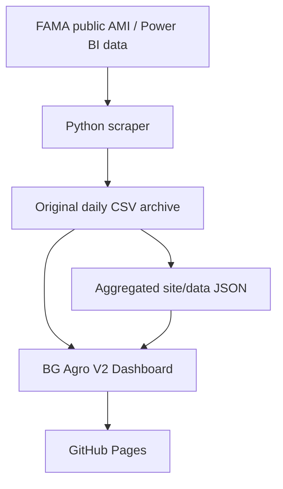

# BG Agro · FAMA Price Tracker

**Malaysia agricultural market prices, made easier to explore.**

An independent BG Agro dashboard built from publicly available **FAMA (Federal Agricultural Marketing Authority)** market price observations. Search produce prices, compare Malaysian states, inspect price changes and export original records for review.

**[Open Live Dashboard](https://luke2929.github.io/bg-agro-price-tracker/)** · [Browse Original CSV Archive](data/daily/) · [View Automated Updates](https://github.com/Luke2929/bg-agro-price-tracker/actions/workflows/scrape.yml)

> **中文简介：** BG Agro 将 FAMA 的农业市场调查价格整理成简洁的 Dashboard。你可以按蔬菜、州属、日期和价格层级查询，比较历史变化，也可以将指定日期范围的原始数据下载成 Excel。数据按计划自动更新，**不是即时交易报价**。

## Algorithm V2 — consistent FAMA comparisons

The dashboard uses a transparent, stock-style **survey price** model, not an exchange-traded price feed:

- **Product identity:** variety, grade and unit are kept separate. Price level (Ladang, Borong, Runcit) and selected state are matched separately.
- **Daily market price:** equal-weight mean of observed FAMA market averages; repeated survey rows at one market do not give that market more influence.
- **1D:** compare with the most recent prior day that has observations in the **same markets**, searching at most 7 calendar days back. The actual baseline date is displayed.
- **7D / 30D:** use the nearest earlier comparable survey on or before the 7/30-day target, no more than 4/7 days older respectively. Actual dates and both matched prices are displayed.
- **Price change:** `(current matched-market mean − previous matched-market mean) / previous matched-market mean × 100%`. A comparison requires at least one identical market. Changes from fewer than 3 matched markets are marked **low sample**. Comparisons covering less than half the current or historical markets are marked **low coverage**. Both are excluded from Top Movers.
- **Top Movers:** sort absolute changes among products with **3+ matching markets and at least 50% coverage on both dates**, so one unusual market cannot dominate the ranking.
- **Trend modes:** *Single Market* draws one market's actual readings (most stock-like, no basket changes); *State Survey Average* is an indicative cross-sectional mean and can be affected by changes in surveyed market coverage.
- **Archive completeness:** generated metadata includes an explicit list of archived CSV dates. A missing expected file is treated as a download error, while non-reporting dates remain genuinely absent. Per-day CSV content revisions prevent unrelated archive refreshes from invalidating every cached download.
- **Exports:** Full Raw Excel continues to include the original 17 CSV fields; missing prices are never fabricated. Survey data are not stock trades, so no artificial OHLC candlesticks or volumes are generated.

## What you can do

| Feature | Description |
| --- | --- |
| **Market Prices** | Browse recorded prices by product, category, state, grade and survey date. |
| **Three Price Levels** | Compare **Ladang** (farm-gate), **Borong** (wholesale) and **Runcit** (retail) observations. |
| **1D / 7D / 30D Changes** | Compare the same product, grade, unit, price level and market on exact calendar dates. |
| **Top Movers** | See the largest comparable price increases and decreases for the selected price level. |
| **Compare & Trends** | Explore state-level prices, recorded history and individual market observations. |
| **Data & Export** | Filter original observations by date range, product, state, level, grade and market. |
| **Excel Downloads** | Export **Summary Data** for analysis or **Full Raw Data** with all 17 original FAMA fields. |
| **Automatic Updates** | GitHub Actions checks new data four times daily, with a full rolling-window verification each night. |

## Using the Dashboard

1. Open the **[BG Agro Dashboard](https://luke2929.github.io/bg-agro-price-tracker/)**. The latest available original CSV observations load automatically; you do not need to import a file.
2. In **Prices**, choose a vegetable, state or date. Switch between Ladang, Borong and Runcit to inspect price changes.
3. In **Compare & Trends**, select one product and price level to compare states and recorded historical prices.
4. In **Data & Export**, select the date range and filters. Use **Load selected range** for older archived dates, then download the Excel file you need.

### Understanding the numbers

- **Survey date (`tarikh_harga`)** is the date the FAMA price observation belongs to. **`systemdate`** is a separate timestamp recorded in the source data.
- **Market price averages** in the main table use the observations available under the selected filters.
- **1D / 7D / 30D percentages** use the closest eligible historical survey within the defined lookback limits, and display its actual date. They use markets appearing on both dates for a like-for-like comparison.
- **Top Movers prices** are averages **across matched markets**. They may differ from the main table's average across all reporting markets.
- A dash (**—**) means there is no valid comparable observation. Missing dates or prices are **not** filled in, estimated or treated as zero.

These are FAMA survey observations, **not offers, guaranteed transaction prices or price forecasts**. Market coverage may vary by date, state and produce type.

## Summary Data vs Full Raw Data

| Excel export | Intended use | What's inside |
| --- | --- | --- |
| **Summary Data** | Quick review and internal analysis | Observed daily averages grouped by date, produce, state, price level, grade and unit, with counts. |
| **Full Raw Data** | Sharing original observations with customers or partners | Individual source records with the original 17 data fields (no summary averages replacing source prices). |

Full Raw Data fields:

`priceid`, `tarikh_harga`, `systemdate`, `negeri`, `daerah`, `lokasi`, `peringkat`, `sublevel`, `kategori`, `kumpulan`, `jenis`, `varieti`, `gred`, `unit`, `harga`, `average14`, `supply`.

The dashboard initially loads up to **38 calendar days** of original CSV records to support recent comparisons. Unchanged daily CSV files keep a stable content-based cache revision; corrected files receive a new revision. Date and product indexes reduce repeated searches across the loaded records. Older dates in the repository are fetched **on demand** when you select them. A selected-range export checks that the requested dates have been retrieved; it does not silently produce a partial customer file when a download fails.

## Data source and coverage

- **Official data source:** [FAMA — Harga Pasaran Terkini](https://www.fama.gov.my/harga-pasaran-terkini), using publicly accessible AMI / Power BI observations.
- **Archived original data:** [`data/daily/YYYY-MM-DD.csv`](data/daily/) in this repository.
- **Archive start:** 27 June 2026; the history grows as new observations are collected.
- **Latest available date:** Shown inside the Dashboard; it depends on FAMA reporting and the most recent successful synchronization.
- **Scope:** Malaysian agricultural produce covered by the source, including vegetables, fruit and other reported categories. Reporting coverage is not necessarily uniform across states or days.

## How the data is updated



The [GitHub Actions workflow](.github/workflows/scrape.yml) runs automatically at:

| Malaysia Time (MYT, UTC+8) | UTC cron |
| --- | --- |
| **1:15 PM** (recent 5 survey dates) | `15 5 * * *` |
| **5:15 PM** (recent 5 survey dates) | `15 9 * * *` |
| **9:15 PM** (recent 5 survey dates) | `15 13 * * *` |
| **11:15 PM** (full rolling window) | `15 15 * * *` |

It can also be triggered manually. Manual executions and code pushes always verify the complete source window, run both test suites, and rebuild the dashboard JSON; routine scheduled checks skip the unchanged-code regression suite and reuse existing aggregates when the CSV archive has not changed. The full nightly scan still captures older corrections and late records. The workflow deploys `site/` to GitHub Pages. This is **scheduled, automatically refreshed data**, not a second-by-second live feed; GitHub Actions may start later than its nominal schedule.

## Project structure

| Path | Purpose |
| --- | --- |
| [`scraper/`](scraper/) | FAMA data retrieval and aggregation logic. |
| [`data/daily/`](data/daily/) | Archived original daily CSV observations. |
| [`site/`](site/) | BG Agro V2 Dashboard and prepared JSON data. |
| [`.github/workflows/scrape.yml`](.github/workflows/scrape.yml) | Automated scraping and GitHub Pages deployment. |
| [`tests/`](tests/) | Existing scraper and aggregation tests. |

For development and verification:

```bash
python -m pytest tests/
python -m scraper.scrape
python -m scraper.aggregate
cd site && python -m http.server 8000
```

The Python scraper uses the standard library. The dashboard is a static HTML/JavaScript app; its original daily CSV files are read from this public GitHub archive.

## Credits and disclaimer

- **Dashboard customization and project:** [BG Agro / Luke2929](https://github.com/Luke2929).
- **Price observations:** [Federal Agricultural Marketing Authority (FAMA), Malaysia](https://www.fama.gov.my/).

BG Agro is an **independent project** and is **not an official FAMA website** or endorsed by FAMA. Please verify important price or purchasing decisions against the original source and relevant market participants.
