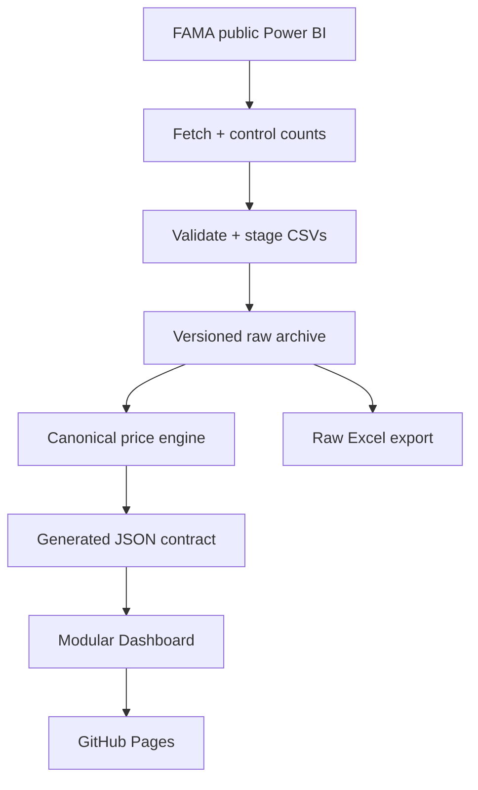

# BG Agro V3 — architecture audit and staged rebuild

Status: **Phases 1–3 foundations underway**, isolated from the production
`master` branch. The complete V3 application and external scheduler are not
yet released.
Baseline commit: `2f56ae94` (2026-11-06). This document is a migration contract,
not a claim that the entire V3 rebuild has shipped.

## Verified baseline

- 131 `data/daily/YYYY-MM-DD.csv` archives, dated 2026-06-27 through 2026-11-06.
- 470,480 archived rows, including 220 older versions of re-dated FAMA `priceid`s;
  470,260 canonical rows in the current generated metadata.
- 119 Python and 19 Node.js tests pass on the baseline.
- Frontend is one ~162 KB `site/index.html` with four embedded JavaScript blocks.
- GitHub Actions has missed/delayed time-zone schedules. Successful scraper code
  and a successful `push` event do **not** prove scheduled delivery is reliable.

## Contracts that must survive every phase

1. **Archive is the source of truth.** Never delete `data/daily/*.csv` or drop a
   historical `priceid` while replacing application code. Preserve all 17 original
   FAMA columns, including empty prices and old versions of re-dated records.
2. **Date meaning is explicit.** `tarikh_harga` is survey date; `systemdate` is
   FAMA entry time; scrape/execution/deployment time are different timestamps.
   Missing survey dates remain missing — never synthesize prices or zeros.
3. **Comparable prices use equivalent observations.** Match variety, grade,
   unit, market, state and price level. Equal-weight distinct markets. A 1D
   comparison searches the preceding 7 days; 7D/30D use bounded older baselines.
   Top Movers require >=3 matched markets and >=50% coverage on both dates.
4. **Full Raw Export** retains all 17 CSV fields, blanks and archived revisions.
   Summary excludes superseded versions. Selected-range exports fail loudly on
   missing files rather than silently exporting incomplete customer data.
5. **User-visible features** remain: Chinese/Malay produce search, three price
   levels, state/market filters, 1D/7D/30D, Top Movers, Watchlist, 7/30/90-day
   history, bar chart, state comparison, date-range data table, printable summary,
   Summary Excel and Full Raw Excel.
6. **Static public GitHub Pages** remains the production destination. Existing
   `master` must stay usable until the rebuilt modules pass parity and E2E tests.

## Data flow

The live V2.2 aggregator still produces legacy, row-weighted series JSONs,
while the browser implements equal-market matched comparisons. These are **not**
interchangeable. V3 will establish one versioned calculation contract and require
Python/JavaScript parity fixtures before switching consumers.

## Phase gates

| Phase | Deliverable | Release gate |
| --- | --- | --- |
| **1 — Audit and preservation** | Baseline, archive validator, no-loss guard, tests, docs | All raw CSVs untouched; old + new tests pass |
| 2 — Ingestion V3 | Fetch/verify all selected days before publishing; staging, idempotent merge, retries, run diagnostics | Corrupt/partial fetch cannot enter archive; simulated failures pass |
| 3 — Price contract V3 | Shared fixtures for identity, latest, matched markets, 1D/7D/30D, canonical revisions | Python and browser generate identical fixture outputs |
| 4 — Modular frontend | Extract CSS, data loader, price engine, charts, filters, exports from monolithic HTML | All existing views work; screenshot + browser E2E parity |
| 5 — Scheduling and health | Job health/run timestamps, scheduled checks and independent external trigger adapter | Prove actual unattended scheduled runs; distinguish stale source from missed job |
| 6 — Cutover | Shadow compare to V2.2, full archive/diff checks, production release | Tests pass, data counts preserved, reversible deployment |

## Automation boundaries

GitHub's `schedule` event is best-effort: changing Python or cron syntax cannot
guarantee timely scheduling. V3 can prepare `workflow_dispatch`/
`repository_dispatch` integration, but a genuinely independent scheduler requires
an authorized external service or execution environment. Do not claim this is
active without an end-to-end scheduled trigger test.

## Production release and rollback

- Work in `rebuild/v3-*` branches; submit reviewable PRs instead of replacing
  `master` in one commit.
- Diff `data/daily/` against the baseline; archive changes must be additive or
  enrich existing records, never remove historical rows.
- Keep original `site/index.html` until an alternative passes feature, visual,
  performance and export tests. Do not remove `site/data/slugs.json`.
- A release is reversible by reverting the V3 code PR without reverting or
  deleting later CSV data commits.

## Phase 1 findings and corrections

- Archive preservation was not an explicit CI gate; the new validator runs on
  every scrape **before** aggregation or commit and checks against Git `HEAD`.
- README / DESIGN contain stale scheduling or legacy aggregation descriptions;
  the V3 plan is the authoritative migration roadmap until those documents are
  updated alongside the corresponding feature phases.
- No external backup scheduler has been provisioned yet. That work is isolated
  to Phase 5 because it needs a provider and authorized credentials.

## Phase 2 — first ingestion safety milestone

- All selected survey dates are fetched, checked against source control counts,
  checked for duplicate/empty `priceid` and mismatched survey dates, and merged
  **in memory** before any changed CSV is written.
- If any later date fails to fetch, mismatches the control count, or has bad
  identities, **no earlier day's prepared update is written**. Six new offline
  regression cases cover these scenarios and successful multi-day publication.
- Changed individual CSVs still use same-directory temporary files and atomic
  `os.replace`. Remote publication is atomic at Git commit granularity.
- Remaining Phase 2 work: structured run status and bounded-memory disk staging;
  the current in-memory preparation covers FAMA's approximately 30-day window.

## Phase 3 — initial calculation parity milestone

- `scraper/market_math.py` is a read-only reference implementation of the
  browser's Algorithm V2 (equal-market averages, same-market 1D/7D/30D
  changes, bounded lookback, grade/unit/state separation and Top Movers
  eligibility).
- Python and Node.js independently execute the same versioned fixtures in
  `tests/fixtures/market_math_v3.json`. This catches accidental divergence
  before the generated data contract or production UI is switched.
- Existing legacy JSON files are **not replaced** during this milestone.
  Remaining Phase 3 work includes real-archive cross-language samples,
  versioned generated endpoints and a staged consumer migration.

## V3 stage 2 — versioned data engine, interface, backup adapter (2026-11-06)

This section supersedes the older status notes above without implying that
the **unmerged** PR has shipped to production.

- `scraper/aggregate_v3.py` builds **new and separate** `site/data/v3/overview.json`,
  `history-index.json` and 291 per-product history JSON files. The archive is
  canonicalized first; every market votes equally and superseded IDs remain
  archived but do not distort current prices or history.
- The complete 131-file source archive has been processed in a temporary output
  directory: 470,480 raw rows, 470,260 canonical, 220 historical revisions,
  795 fresh latest-day price combinations, 16 states and federal territories.
  291 product history contracts are independently validated. Nothing in
  `data/daily/*.csv` was rewritten by the V3 build.
- `site/v3/` contains a separate responsive frontend, with latest prices,
  same-market 1D/7D/30D ranked movers, market-level source browsing, date/state
  filters, 30/90/180-day history, state comparisons, browser-local Watchlist,
  and Summary/Full Raw `.xlsx` exports. The full raw export retains all 17
  original columns and revisions; Summary uses equal-weight markets and the
  global superseded priceid manifest.
- The original `site/index.html` is preserved for advanced classic features
  and remains the public production route. Before cutover, additionally test
  single-market chart parity, long-range export performance, and mobile layout
  in a real browser; the standalone V3 chart currently displays national/state
  series, while the classic dashboard still offers single-market chart mode.
- `ops/cloudflare-backup/` contains an **uninstalled** independent scheduler
  using GitHub workflow run timestamps and `workflow_dispatch`. It runs only if
  Luke explicitly approves a Cloudflare account/provider and installs the
  restricted GitHub token through encrypted Worker secrets. No token is in Git.
- V3 CI now builds contracts from the real archive, validates product history,
  runs Python/Node tests, checks source archive integrity, and packages a
  review artifact. It **does not deploy** or commit master data. Upon future
  authorized merge, the existing master-only scrape workflow can publish the
  additive V3 contracts while leaving classic routes in place.

### Current gates and remaining work

| Gate | State | Evidence / next action |
| --- | --- | --- |
| Preserve full original FAMA history | PASS locally | 131 CSVs untouched; archive validator + real-archive reconciliation |
| Python/JS comparison correctness | PASS locally | 150 Python + 42 Node tests; same-market fixtures |
| Versioned generated API | PASS locally | 795 latest price groups, 291 history files, no synthetic dates |
| Modular V3 UI and Excel | IMPLEMENTED, browser QA pending | Real Chrome/mobile smoke, correct exports and long-range memory |
| GitHub production scheduled update | NOT PROVEN | Wait for real unattended `schedule` executions after merge |
| Independent cloud fallback | CODE ONLY | Choose provider, configure secret, observe two genuine runs |
| Production go-live | NOT AUTHORIZED | Review PR, end-to-end regression, compare with classic, approve rollout |

### Preview and recovery

1. Run `python -m scraper.aggregate_v3 --history-dir site/data/v3/history`.
2. Run `python -m scripts.validate_v3`, `python -m pytest -q`, and
   `node --test tests/test_*.mjs tests/test_dashboard_algorithm.cjs tests/test_market_math_v3.cjs`.
3. Serve the repo's `site/` directory through an HTTP server; open `/v3/`.
   Live raw CSV browsing/exports require internet access to the repository's
   original `master/data/daily` files.
4. The V3 implementation stays behind `/v3/`; revert the code PR if needed.
   Do **not** revert any later legitimate raw FAMA data commits or delete
   historic original CSVs. The original `/` page remains available.
