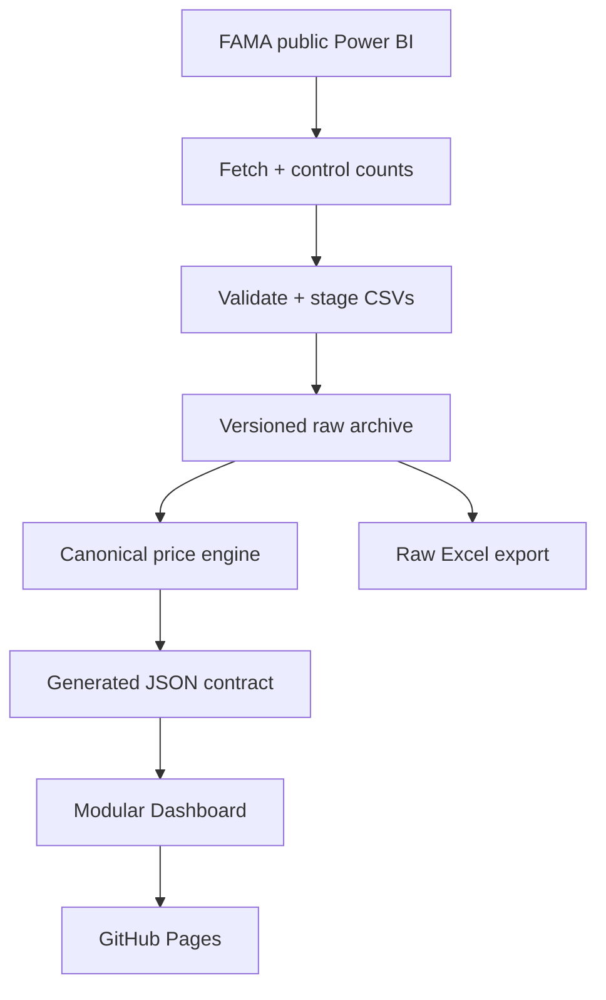

# BG Agro V3 — architecture audit and staged rebuild

Status: **Phase 1 implementation**, isolated from the production `master` branch.
Baseline commit: `2f56ae94` (2026-11-06). This document is a migration contract,
not a claim that the entire V3 rebuild has shipped.

## Verified baseline

- 131 `data/daily/YYYY-MM-DD.csv` archives, dated 2026-06-27 through 2026-11-06.
- 470,480 archived rows, including 220 older versions of re-dated FAMA `priceid`s;
  470,260 canonical rows in the current generated metadata.
- 119 Python and 19 Node.js tests pass on the baseline.
- Frontend is one ~162 KB `site/index.html` with four embedded JavaScript blocks.
- GitHub Actions has missed/delayed time-zone schedules. Successful scraper code
  and a successful `push` event do **not** prove scheduled delivery is reliable.

## Contracts that must survive every phase

1. **Archive is the source of truth.** Never delete `data/daily/*.csv` or drop a
   historical `priceid` while replacing application code. Preserve all 17 original
   FAMA columns, including empty prices and old versions of re-dated records.
2. **Date meaning is explicit.** `tarikh_harga` is survey date; `systemdate` is
   FAMA entry time; scrape/execution/deployment time are different timestamps.
   Missing survey dates remain missing — never synthesize prices or zeros.
3. **Comparable prices use equivalent observations.** Match variety, grade,
   unit, market, state and price level. Equal-weight distinct markets. A 1D
   comparison searches the preceding 7 days; 7D/30D use bounded older baselines.
   Top Movers require >=3 matched markets and >=50% coverage on both dates.
4. **Full Raw Export** retains all 17 CSV fields, blanks and archived revisions.
   Summary excludes superseded versions. Selected-range exports fail loudly on
   missing files rather than silently exporting incomplete customer data.
5. **User-visible features** remain: Chinese/Malay produce search, three price
   levels, state/market filters, 1D/7D/30D, Top Movers, Watchlist, 7/30/90-day
   history, bar chart, state comparison, date-range data table, printable summary,
   Summary Excel and Full Raw Excel.
6. **Static public GitHub Pages** remains the production destination. Existing
   `master` must stay usable until the rebuilt modules pass parity and E2E tests.

## Data flow

The live V2.2 aggregator still produces legacy, row-weighted series JSONs,
while the browser implements equal-market matched comparisons. These are **not**
interchangeable. V3 will establish one versioned calculation contract and require
Python/JavaScript parity fixtures before switching consumers.

## Phase gates

| Phase | Deliverable | Release gate |
| --- | --- | --- |
| **1 — Audit and preservation** | Baseline, archive validator, no-loss guard, tests, docs | All raw CSVs untouched; old + new tests pass |
| 2 — Ingestion V3 | Fetch/verify all selected days before publishing; staging, idempotent merge, retries, run diagnostics | Corrupt/partial fetch cannot enter archive; simulated failures pass |
| 3 — Price contract V3 | Shared fixtures for identity, latest, matched markets, 1D/7D/30D, canonical revisions | Python and browser generate identical fixture outputs |
| 4 — Modular frontend | Extract CSS, data loader, price engine, charts, filters, exports from monolithic HTML | All existing views work; screenshot + browser E2E parity |
| 5 — Scheduling and health | Job health/run timestamps, scheduled checks and independent external trigger adapter | Prove actual unattended scheduled runs; distinguish stale source from missed job |
| 6 — Cutover | Shadow compare to V2.2, full archive/diff checks, production release | Tests pass, data counts preserved, reversible deployment |

## Automation boundaries

GitHub's `schedule` event is best-effort: changing Python or cron syntax cannot
guarantee timely scheduling. V3 can prepare `workflow_dispatch`/
`repository_dispatch` integration, but a genuinely independent scheduler requires
an authorized external service or execution environment. Do not claim this is
active without an end-to-end scheduled trigger test.

## Production release and rollback

- Work in `rebuild/v3-*` branches; submit reviewable PRs instead of replacing
  `master` in one commit.
- Diff `data/daily/` against the baseline; archive changes must be additive or
  enrich existing records, never remove historical rows.
- Keep original `site/index.html` until an alternative passes feature, visual,
  performance and export tests. Do not remove `site/data/slugs.json`.
- A release is reversible by reverting the V3 code PR without reverting or
  deleting later CSV data commits.

## Phase 1 findings and corrections

- Archive preservation was not an explicit CI gate; the new validator runs on
  every scrape **before** aggregation or commit and checks against Git `HEAD`.
- README / DESIGN contain stale scheduling or legacy aggregation descriptions;
  the V3 plan is the authoritative migration roadmap until those documents are
  updated alongside the corresponding feature phases.
- No external backup scheduler has been provisioned yet. That work is isolated
  to Phase 5 because it needs a provider and authorized credentials.
